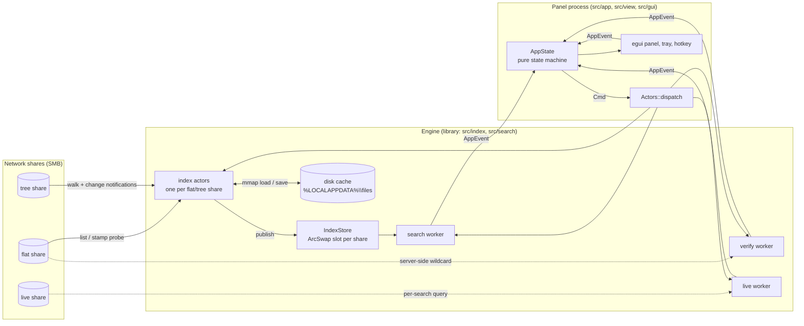
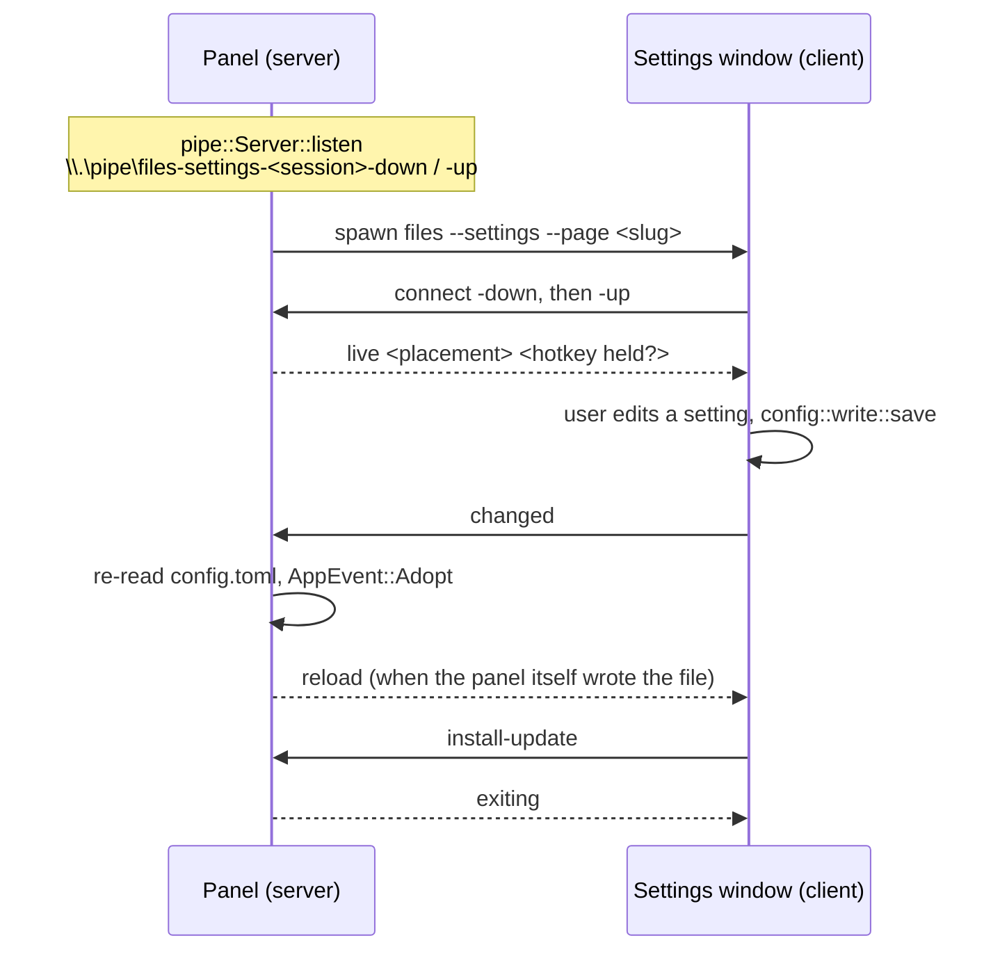
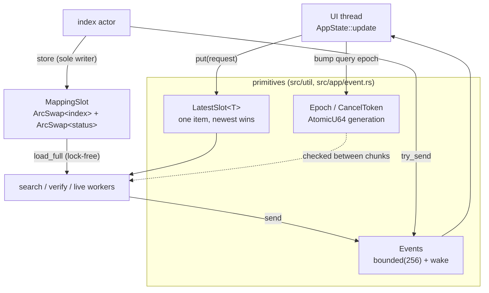
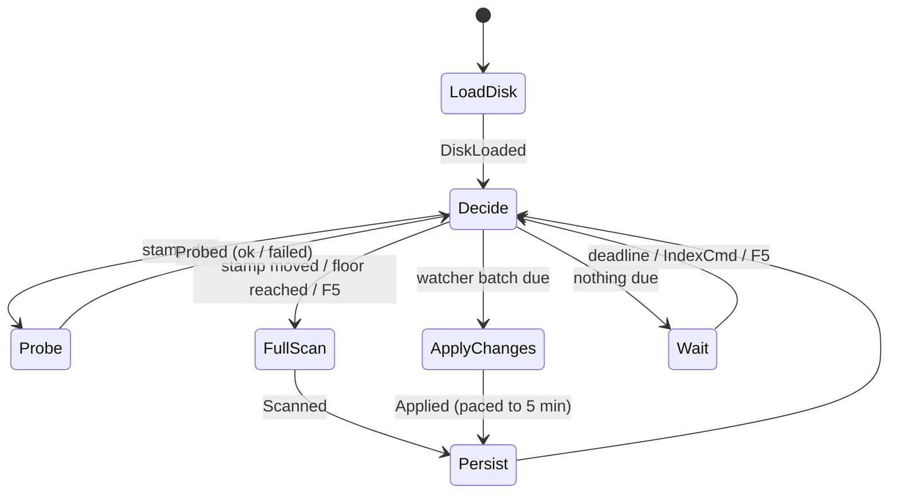
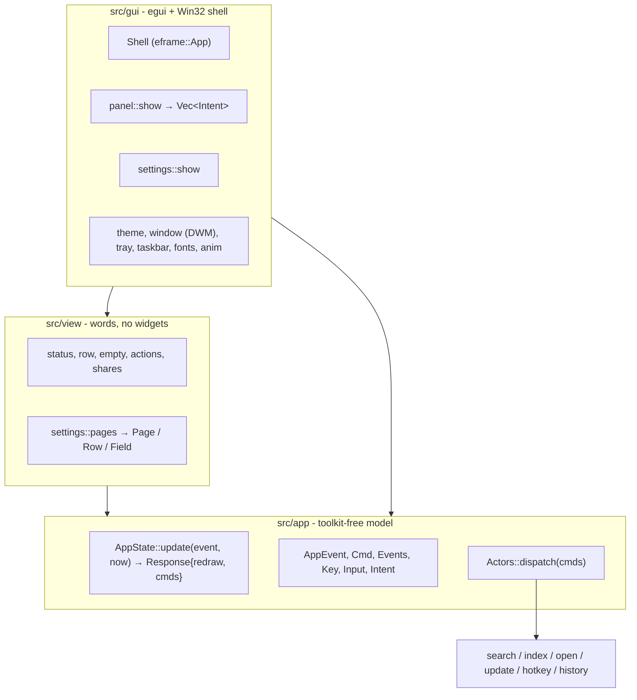
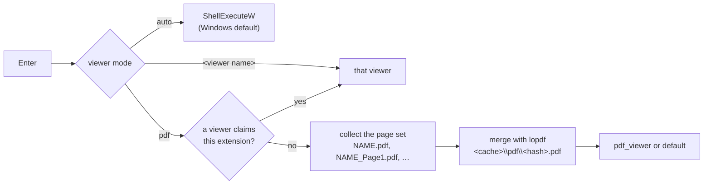
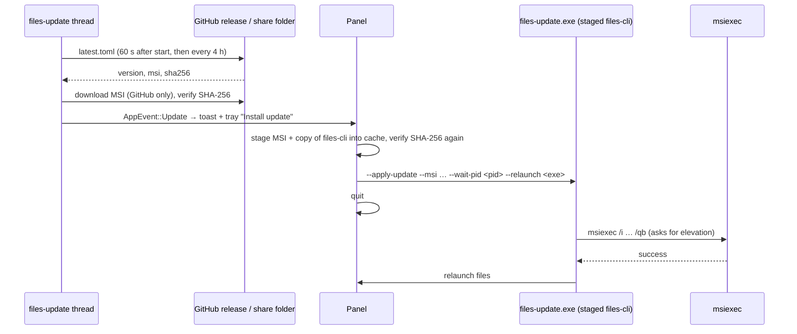

# Architecture

This document explains how `files` works inside: which processes and threads exist, how a share becomes an in-memory index, how a keystroke becomes ranked results, and how the UI, configuration, updates and file opening fit together. Module paths point into `src/`. Each module's own `//!` comment holds the detail.

- [1. The big picture](#1-the-big-picture)
- [2. Processes](#2-processes)
- [3. Threads and how they talk](#3-threads-and-how-they-talk)
- [4. The index pipeline](#4-the-index-pipeline)
- [5. The search pipeline](#5-the-search-pipeline)
- [6. UI layering](#6-ui-layering)
- [7. Configuration](#7-configuration)
- [8. Opening files and merging PDFs](#8-opening-files-and-merging-pdfs)
- [9. Updates and the installer](#9-updates-and-the-installer)
- [10. Design decisions](#10-design-decisions)
- [11. Known gaps](#11-known-gaps)

## 1. The big picture

`files` answers one question very fast: *which files on these shares have this in their name?* Listing a large SMB directory takes seconds to minutes, so the program never lists on demand when it can avoid it. Each share is read in the background, held in memory as compact arenas, cached on local disk, and kept fresh by cheap change checks. A search is then a SIMD scan over memory, which takes single-digit milliseconds per million names.



The crate is **one library and two thin binaries**. All logic lives in the library (`src/lib.rs`), so integration tests and benchmarks can reach it.

| Binary | Source | Subsystem | Role |
|---|---|---|---|
| `files.exe` | `src/main.rs` | Windows GUI, no console | The tray app and search panel, or with `--settings` the settings window |
| `files-cli.exe` | `src/bin/files-cli.rs` | Console | `--check-config`, `--doctor`, `--bench`, `--help`, `--version`, and the internal `--apply-update` helper |

There are two executables because the PE subsystem bit, which decides whether a shell waits for output, is set per executable.

## 2. Processes

### 2.1 The panel (`files`)

Start-up in `src/main.rs`:

1. `log::install()` sends `log` output to stderr and `OutputDebugStringW`. The level comes from `FILES_LOG`.
2. `cli::parse_env()` reads the command line. `Args::settings()` then builds `Settings` by layering file, environment and command line (§7). A config error is fatal, with no silent fallback to defaults.
3. `Mode::Gui` → `run_gui`:
   - Picks the directory source (`WinDirSource`).
   - Creates the app directories.
   - Spawns `files-prewarm`. It touches every enabled share root once so SMB session setup and DFS referrals start early.
4. `gui::run` builds the `egui::Context` *before* the window, so workers can wake it. It then claims single-instance and starts eframe (OpenGL/`glow`; frameless, transparent, always-on-top, hidden until summoned).

**Single instance** (`src/single.rs`) uses a named mutex `Local\files-single-instance` and a named auto-reset event `Local\files-summon`. Both are per session, so terminal-server users don't collide. A second launch finds the mutex, sets the event and exits. The first instance's `files-single` thread wakes and posts `Request::Show`. An event is used rather than a window message because the toolkit owns the window and there is no window procedure to hook.

### 2.2 The settings window (`files --settings`)

The settings UI is a separate process. A crash or slow diagnostic there can never freeze the panel. The panel spawns it detached (`gui/link.rs`, `PanelLink`), and it also runs with no panel at all, editing `config.toml` directly.

The two processes talk over **named pipes** (`src/ipc`):



- **Two half-duplex pipes**, `-down` (panel→window) and `-up` (window→panel). One synchronous duplex handle would deadlock a pending `ReadFile` against a `WriteFile`.
- **Flags:** `PIPE_TYPE_MESSAGE | PIPE_READMODE_MESSAGE | PIPE_REJECT_REMOTE_CLIENTS`, one instance, 4 KiB messages. The pipe name includes the session ID.
- **Wire format** (`ipc/wire.rs`): one ASCII line per message, a verb then space-separated, percent-escaped fields.
  - `ToSettings`: `show`, `close`, `live`, `reload`, `exiting`.
  - `ToPanel`: `changed`, `install-update`, `forget-placement`, `closing`.
  - The decoder is *total*: a malformed line decodes to `None` and never panics, because any local process can connect.
- **Liveness:** a shared `AtomicBool` that any read or write failure clears. The `Link` trait has an in-memory `Pair` implementation for tests.

### 2.3 The update helper

To install an update, the panel stages a copy of `files-cli.exe` as `files-update.exe` and starts it with `--apply-update`. The helper waits for the panel to exit, runs `msiexec`, and relaunches `files` (§9).

## 3. Threads and how they talk

### 3.1 Thread inventory

No long-lived threads are added after the panel starts. `main` starts `files-prewarm`, `gui::run` starts `files-single`, `Actors::start` starts the engine threads (index, search, open, update, hotkey, history), and `gui::Shell::new` starts the rest of the shell (placement, taskbar, pipe). Two one-shot helpers run blocking calls off the UI thread: `files-clipboard` for copy and paste, and `files-config-write` when F2 saves the viewer choice.

| Thread | Module | Fed by | Reports via | Purpose |
|---|---|---|---|---|
| UI / event loop | eframe | window events, `Request` channel, pipe, `Events` | `Cmd` → `Actors::dispatch` | Owns `AppState` and draws the panel |
| `files-index` (one per flat/tree share) | `index/actor.rs` | `IndexCmd` channel (bounded 16) + stop flag | `MappingSlot` publish + `AppEvent::Index` | Load cache, scan, walk, probe, apply changes, persist |
| `files-watch` (one per watched tree share) | `index/actor.rs` → `index/watch.rs`, over `index/win_watch.rs` | `ReadDirectoryChangesW` | `WatchQueue` + `IndexCmd::Changed` | Change notifications |
| walk workers (scoped, 8 per walk) | `index/walk.rs` | shared LIFO frontier | the walk's sink | Parallel directory reads during a tree walk |
| `files-search` | `search/worker.rs` | `LatestSlot<SearchRequest>` | `AppEvent::Search` | In-memory match over every indexed share |
| `files-verify` | `search/worker.rs` | `LatestSlot` | `AppEvent::Verify` | Stamp probe or server-side wildcard check on a single flat share |
| `files-live` | `search/worker.rs` | `LatestSlot` | `AppEvent::Live` | Per-search queries against live shares |
| rayon pool | global | matcher chunks | — | Parallel arena sweeps |
| `files-open` | `open/worker.rs` | `OpenRequest` channel (FIFO, bounded 16) | `AppEvent::Open` | Launch viewers, merge PDFs (parses untrusted files; catches panics) |
| `files-update` | `update/check.rs` | `Ask` channel | `AppEvent::Update` | First check after 60 s, then every 4 h |
| `files-hotkey` | `hotkey/win.rs` | Win32 message pump (`WM_HOTKEY`, `WM_APP_*`) | `AppEvent::Hotkey` | The only thread that shows, hides or focuses the window |
| `files-history`, `files-placement` | `history.rs`, `placement.rs` | coalescing slot | files in `%APPDATA%\files` | Write search history and window position |
| `files-single`, `files-ipc-*`, `taskbar-theme`, `files-prewarm` | various | events, pipes, registry | `Request` / pipe | Shell plumbing |

### 3.2 Channels and shared state



- **`Events`** (`app/event.rs`) is the single way into the UI thread. Every send also calls `request_repaint`, and the type has no `Deref`, so nobody can send without waking the UI.
  - `send` (blocking) is for results the UI must see.
  - `try_send` (drops when full) is for progress, and is the only form allowed *from* the UI thread.
- **`LatestSlot<T>`** (`util/latest_slot.rs`) is a one-item mailbox where the newest value wins. Typing fast replaces queued searches, but the final request is never lost.
- **`Epoch` / `CancelToken`** (`util/cancel.rs`) is a shared generation counter. The search worker's epoch *is* the UI's query epoch, so one number cancels stale work and also lets the UI drop stale results. Tokens are checked between rayon chunks, between shares and between buffer refills.
- **`MappingSlot`** (`index/store.rs`) holds two `ArcSwap`s per share, one for the current index and one for its status. Each slot has exactly one writer (its index actor, or for a live share the live worker) and any number of lock-free readers.
- **`WalkPermits`** (`index/permit.rs`) is a counting semaphore built on a bounded channel, so waiting can `select!` against the actor's command channel. It caps how many shares are walked at once (`max_concurrent_scans`, default 2).

### 3.3 Shutdown

Quit sets `should_quit`. The panel tells a connected settings window `exiting` and closes the viewport. Threads that own a `Drop` (the hotkey thread, the history and placement writers) clean up. The process then ends. Index actors are not joined at exit. `Actors::shutdown` exists, with a 250 ms per-thread join budget, but today only tests call it (see [Known gaps](#11-known-gaps)). Exiting without waiting is deliberate in one respect: an SMB call cannot be cancelled, and quitting must never hang on a dead share.

## 4. The index pipeline

### 4.1 Mapping kinds

Each `[[mapping]]` in the config is one of three kinds (`src/paths.rs`):

| Kind | Held in memory | Kept fresh by | Default refresh | Best for |
|---|---|---|---|---|
| `flat` | yes, one `Snapshot` | stamp probe every ~60 s; full rescan when the stamp moves, or at least hourly | `auto` | one huge directory (hundreds of thousands of files) |
| `tree` | yes, a segmented `TreeIndex` | `ReadDirectoryChangesW` on the root, debounced and patched; a floor re-walk every 30 min only with `refresh = "auto"` | `manual` (F5) | a folder hierarchy |
| `live` | no (results seen are remembered) | asked on every search, depth 1–4, with a round-trip budget | — | shares too big or too volatile to index |

`refresh = "manual"` means the share is only rescanned when the user presses F5. `MappingId` is the mapping's position in the configured list.

### 4.2 Reading a directory: `DirSource`

All directory access goes through `trait DirSource` (`index/enumerate.rs`): `list`, `probe_stamp`, `query` (server-side wildcard), `prewarm`. Entries are pushed as UTF-16 straight into an `EntrySink`, with no intermediate `Vec<String>`.

`WinDirSource` (`index/win_enum.rs`) tries strategies in order and moves on only when one is unsupported or returns a malformed buffer (`EnumError::should_try_next_strategy`):

| Strategy | API | Per round trip | Notes |
|---|---|---|---|
| `handle-dirinfo` (default) | `GetFileInformationByHandleEx(FileFullDirectoryInfo)` | up to 1 MiB | halves toward 64 KiB if the server caps transfers (SMB 2.0.2) |
| `findfirstex` | `FindFirstFileExW(FindExInfoBasic, FIND_FIRST_EX_LARGE_FETCH)` | 64 KiB | the only API that takes a pattern, so it also serves `query` |
| `std` | `std::fs::read_dir` | ~4 KiB | last resort; also the portable backend (`std_enum.rs`) |

Buffers returned by the server are treated as untrusted. Every header, name length and next-entry offset is bounds-checked, and iteration is capped. `FakeDirSource` (`index/fake_source.rs`) implements the same trait in memory for tests and `--demo`.

**Tree walks** (`index/walk.rs`) run 8 scoped workers over a shared LIFO frontier. Limits: depth 32, 1 M folders, 8 M entries. Junctions and other reparse-point folders are never followed. A failed folder is recorded as a hole and is never fatal. Deleted folders are not holes. After 32 consecutive transient failures the walk gives up, so an unreachable share doesn't cost a ~20 s SMB timeout for every folder.

### 4.3 In-memory layout

```text
Snapshot (index/snapshot.rs) - one directory, immutable
  prefix   "V:\shared\files\"                       stored once
  offsets  [0, 13, 27, ...]                         u32 per entry, n+1 values
  lower    "ab-c-0704.pdf\0ab-c-0704_page1.pdf\0…"  case-folded arena
  orig     "AB-C-0704.pdf\0AB-C-0704_Page1.pdf\0…"  original spelling

TreeIndex (index/tree.rs) - a folder hierarchy
  segments: Vec<Arc<TreeSegment>>     sealed by size, 512 KiB doubling to 16 MiB
    files: Snapshot                   names of files
    dirs:  Snapshot                   relative folder paths
    runs:  [Run { first_file, dir }]  which folder each run of files sits in
```

- **One offsets table serves both arenas.** That works because `util::fold` case-folds without changing byte length. Non-ASCII characters whose folded form would be a different length are left alone, and the matcher falls back to a full Unicode comparison when a query needs it.
- **NUL separators** mean a substring hit can never span two names.
- **Tree segments are published during the walk**, so a large share is searchable before the walk finishes. Watcher changes rebuild only the affected segments (`with_subtrees_replaced`).

`IndexStore` (`index/store.rs`) holds one `MappingSlot` per configured mapping, plus a small LRU for single-folder listings (`FolderSlot`, 64 entries, including cached "not found" answers). Nothing outside its tests uses that cache yet. `IndexStatus` records:

- where the index came from: disk cache, network, or observed from live answers;
- when it was built and when it was last confirmed;
- the current activity: queued, loading, scanning, walking, persisting;
- **health**: `Ok`, `Degraded{reason}`, or `Unreachable{err, attempt, next_retry_at}`;
- a stale reason, if any.

### 4.4 The disk cache

`index/persist.rs` writes each share's index to `%LOCALAPPDATA%\files` (or `cache_dir`). That location must be local, because the file is memory-mapped.

- **Format** (version 5): little-endian, magic `FILESIDX`, 128-byte header, 64-byte-aligned sections: `header | prefix | offsets | lower | orig`. Tree files add folder sections and the run table.
  - An FNV-1a checksum covers the header and tables but not the name arenas, so the arenas stay lazily paged.
  - Flags record truncation, stamp kind and tree completeness.
- **Loading.** `memmap2` maps the file read-only, with a share mode that denies writers. The offsets table is copied out with `bytemuck::try_cast_slice`, so no slice bound ever depends on mapped bytes. A cache is rejected, and rebuilt, on any of these:
  - wrong magic or version;
  - a different volume serial, which catches a drive letter remapped to another share;
  - a different prefix;
  - truncation or a checksum mismatch.
- **Writing.** Write to `<key>-<pid>-<nanos>.tmp`, `sync_all`, rename to `<key>-<serial>-<captured>-<written>.idx`, then atomically replace a tiny `latest-<key>` pointer file. Windows can't rename over a mapped file, which is why there is a pointer file. A share's superseded files are removed after each write; files of shares no longer configured are removed at start-up.
- **Age.** An index older than 7 days (`MAX_INDEX_AGE`) is still served, and labelled stale.

### 4.5 The index actor

Each flat or tree share has one `files-index` thread (`index/actor.rs`). It starts by loading the disk cache, so the share is searchable immediately even when the server is down. It then loops:



- **Decisions come from `Scheduler::on(now, input, have_snapshot)`** (`index/schedule.rs`), a pure function with no clock and no I/O, which makes it exhaustively testable. It guarantees two things:
  1. A failed probe never triggers an enumeration.
  2. Two enumerations are never closer than the minimum spacing, except on F5.
- **Waiting** is a channel receive with a deadline, never a sleep. That's why F5 interrupts a backoff immediately.
- **Guards:**
  - An empty listing must be seen twice in a row before it replaces a populated index.
  - Tree walks wait for a `WalkPermit` and show as *queued* meanwhile.
  - Progress events are rate-limited (100 ms or 50 k entries).
  - Panics are caught and reported as `ActorDied`.

| Cadence (`config/mod.rs`) | flat | tree |
|---|---|---|
| Stamp probe | every 60 s ± 10 % | — (watcher instead) |
| Rescan floor | 1 h | 30 min + up to 25 % spread, `refresh = "auto"` only |
| Minimum gap between full scans | 30 s | 5 min |
| Probe backoff | 5 s → 5 min | — |
| Scan backoff (full jitter) | 30 s → 10 min | 30 s → 10 min |
| Save to disk | after each pass; patches at most every 5 min | same |

**Stamps** (`DirStamp`) are the directory's last-write and change times, read in about three round trips. A stamp has a kind: full, or write-time-only from the attribute fallback. Stamps of different kinds never compare equal, and a change of kind counts as one change, so a share that sometimes falls back doesn't rescan on every probe. After two failed probes the share is marked *blind*, and from then on only the rescan floor guarantees freshness.

**Watching** (`index/watch.rs`, `index/win_watch.rs`) is one `ReadDirectoryChangesW(bWatchSubtree)` on the tree root, which becomes a single SMB2 CHANGE_NOTIFY on the server.

- It uses a 64 KiB buffer (the network maximum) and watches names only, not writes.
- Events are debounced for 2 s from the *first* event, then the dirty folders are re-read and patched in.
- An overflow, or more than 1 000 dirty folders, triggers a full re-walk. On a manual share it marks the index stale instead.
- A server that refuses notifications marks the share `Degraded(LiveUpdatesUnavailable)`.

**Failure handling.** Win32 errors are classified once (`index/errors.rs`) into `PathNotFound`, `AccessDenied`, `Transient`, `Unsupported`, `Corrupt`, `TimedOut` and others. A failed refresh never removes the last good index; only `health` changes, and the status line shows a retry countdown. Pre-warming and the volume-serial lookup happen on the actor thread, so a dead share never delays start-up.

## 5. The search pipeline

```mermaid
sequenceDiagram
    participant K as Keyboard
    participant S as AppState (UI thread)
    participant A as Actors::dispatch
    participant W as files-search
    participant M as matcher (rayon)
    K->>S: AppEvent::Key
    S->>S: edit input, bump query_epoch, resolve alias, Query::parse
    S->>S: arm deadlines: search +180 ms, verify +300 ms, live +600 ms
    Note over S: no tick thread: the frame loop asks next_deadline()<br/>and App::pump synthesizes AppEvent::Tick
    S->>A: Cmd::Search{query, epoch}
    A->>W: LatestSlot.put (replaces any queued search)
    W->>M: for each share: search / search_tree
    M-->>W: SearchOutcome{hits, matched, total}
    W->>S: AppEvent::Search{epoch, result}
    S->>S: drop if epoch is stale; keep selection by path; redraw
```

1. **Input.** `gui::input::translate` turns egui events into toolkit-free `AppEvent`s. `AppState::update` edits the input, resolves an alias if the whole line matches one (`src/alias.rs`), and parses the query (`search/query.rs`).
   - The term is never split on spaces, because file names contain spaces.
   - Only `*` (match mode: prefix, suffix, contains) and `ext:` filters are syntax. Windows forbids both `*` and `:` in file names, so they can never clash with a real name.
   - Parsing is total: problems are attached to the query, never raised.
2. **Debounce.** Typed input waits 180 ms. A paste or alias searches immediately.
3. **Match** (`search/matcher.rs`).
   - The query is case-folded to the same byte layout as the `lower` arena. The arena is cut into 8 192-entry chunks and swept in parallel with `memchr::memmem`.
   - Each byte hit is mapped back to its entry, and the cursor jumps past the NUL, so each name gives at most its leftmost hit. A query longer than the share's longest name is rejected in O(1).
   - Tree shares also sweep folder names. Files inside a matching folder are included as "inherited" hits, capped at 64 per folder.
4. **Rank** (`search/topk.rs`). A top-K heap (K = 300) is keyed by one packed `u64`: inherited flag, match position, name length, entry index. The order is strict and total, so parallel and serial runs give identical results, which `tests/matcher_parity.rs` checks. Results from all shares are merged and re-sorted the same way.
5. **Filter.** Hidden extensions, `ext:` filters and the match mode are applied *before* ranking, so the count shown always agrees with the rows.
6. **Show.** `on_search` drops any result whose epoch isn't current. It keeps the selection on the same *path* even when rows move, and opens a deferred <kbd>Enter</kbd> once results arrive.

**Verify** (`search/verify.rs`) applies only when exactly one flat share is configured.

- If the stamp is unchanged, the index is authoritative and nothing is sent.
- Otherwise, with `server_filter` on, the provably literal query is sent as `FindFirstFileExW("dir\*term*")`. NT wildcards can't be escaped, so anything else is skipped.
- The server may return *more* than the index (new files), never fewer. After three disagreements, server filtering turns itself off for the session.

**Live shares** (`search/live.rs`) are queried for terms of 3+ characters, within a 64-round-trip and 1.2 s budget, at most once per second per share. A share that fails three times is disabled. Answers are merged into the list on screen rather than replacing it. They are also remembered as an "observed" index and restored at the next start.

**The frame loop** (`gui/mod.rs`) runs `logic()` every turn, even while hidden: theme, input, `App::pump`, tray requests and update state. It then requests the next repaint at the earliest pending deadline, or every 100 ms while animating. With neither, the process sleeps until a worker, the hotkey or the tray wakes it. `ui()` runs only while the panel is visible.

**Performance targets** (`benches/matcher.rs`, `cargo bench`): single-digit milliseconds per 1 M flat entries, and about 5–16 ms for tree shares of 30 k–300 k folders.

## 6. UI layering



- **`app` is the model.** `AppState::update` is pure: no I/O, no clock reads, no channels, no egui. Effects leave as `Cmd` values, and only `Actors::dispatch` performs them. Because of this, `tests/state_machine.rs` can drive the whole application with a fake clock, and the panel's behavior has well over a hundred tests that need no window.
- **`view` turns state into words.** Its functions return `Block`s of text runs with an `Emphasis` (body, dim, strong, accent, tone). The whole settings form is data: pages of rows with choice, toggle or text fields. `view::style` checks every visible string against the house style.
- **`gui` draws and runs the native shell.**
  - The panel is drawn each frame from `view` text and `theme` constants, and returns `Intent`s (pointer actions already hit-tested), which go straight back into `AppState`.
  - `window` applies DWM backdrop, corners and dark frame.
  - `tray`, `taskbar` (follows the taskbar's light/dark theme) and `drag` handle the rest of the shell.
- **Showing and hiding** belongs to the `files-hotkey` thread. `AppState` follows it through `HotkeyMsg::Summoned` / `Dismissed`.
- **Accessibility.** eframe's `accesskit` feature exposes the panel to Narrator and magnifiers. `tests/panel.rs` asserts on that accessibility tree.

## 7. Configuration

| Layer (lowest first) | Source |
|---|---|
| 1. Built-in defaults | `assets/default_config.toml`, compiled in with `include_str!`. It is parsed by the normal loader, so the template and the defaults cannot drift apart |
| 2. File | `%APPDATA%\files\config.toml` (roams with the profile), or `--config <path>`; `--no-config` skips it |
| 3. Environment | `FILES_*` variables (`files-cli --help` lists them) |
| 4. Command line | `--hotkey`, `--viewer`, `--enum`, … |

- **Parsing** (`config/file.rs`) uses `toml_edit`, so every error carries `file:line:col`. Unknown keys are errors, and all errors are reported at once. `files-cli --check-config` validates without touching the network.
  - Two rules apply to mappings: no two may point at the same folder, and no enabled mapping may sit inside an enabled tree mapping (a tree inside a flat or live share is fine).
- **Writing** (`config/write.rs`) is the only code that changes the file. It preserves the user's formatting and comments, re-parses its own output with the start-up loader before replacing anything, and writes through a temp file and a rename.
  - When a value is pinned by the environment or command line, the settings window says the change applies to the next session only.
- **Migration** (`config/migrate.rs`). The file carries `version = 3`. Older files are upgraded on load: the original is backed up as `config.v<N>.bak`, the file is rewritten, and a notice is shown once.

The template documents every key. In summary:

| Area | Keys |
|---|---|
| Shares | `[[mapping]]` with `name`, `path`, `kind` (`flat`/`tree`/`live`), `enabled`, `refresh` (`auto`/`manual`), `depth` (live only) |
| Panel behavior | `hotkey`, `hide_on_blur`, `hide_after_opening`, `hide_on_escape`, `history`, `stale_notices` |
| Appearance | `theme`, `backdrop`, `result_layout`, `columns`, `dock` |
| Opening | `viewer` (`auto`/`pdf`/a viewer name), `pdf_viewer`, `pdf_read_only`, `[[viewer]]` with `name`, `program`, `extensions` |
| Results | `hide_extensions`, `hide_system_files`, `[[alias]]` with `name`, `code` (the search input it expands to), `note` |
| Engine | `max_concurrent_scans`, `enum_strategy`, `matcher`, `server_filter`, `live_updates`, `persist`, `cache_dir`, `index_log` |
| Updates and support | `check_for_updates`, `update_from`, `dev_mode` |

Window position is kept in `%APPDATA%\files\window.txt` and history in `history.txt`, not in `config.toml`. "Start with Windows" is the registry value `HKCU\Software\Microsoft\Windows\CurrentVersion\Run\files`, shared by the installer, the settings window and Task Manager.

## 8. Opening files and merging PDFs



- `AppState::open_selection` builds an `OpenRequest`, and the `files-open` worker routes it (`open/mod.rs`, `route_of`). Requests are first in, first out. If the queue is full, the user is told that the previous file is still opening.
- **Launching** goes through `ShellExecuteW`, for configured viewers too, never `cmd /c start`, so quoting and `&` in file names are safe. *Reveal* runs `explorer.exe /select,` through `std::process::Command`.
- **Page sets** (`search/pages.rs`) are the base name's `.pdf` plus siblings with a page marker in the same folder: an optional `_`, `-`, `.` or space, then `p`, `pg` or `page` (any case), then a number, as in `NAME_Page2.pdf`, `NAME-p3.pdf` or `NAME page 4.pdf`. They are ordered numerically (`_Page2` before `_Page10`), with at most 512 pages.
- **Merging** (`open/pdf.rs`) resolves inherited `MediaBox`, `Resources`, `CropBox` and `Rotate` before moving pages.
  - The output is named by a hash of its inputs, so an identical request reuses the earlier file. It is marked read-only (`pdf_read_only`) and cleaned up after 7 days.
  - Encrypted, malformed or unreadable pages are skipped, and the user is told which ones.

## 9. Updates and the installer



- **Source** (`update/mod.rs`): `update_from` (a share folder) takes precedence. Otherwise GitHub releases of the repository named in `Cargo.toml`, if `check_for_updates` is on.
  - A share is read with plain file access, needing no HTTP and no extra credentials.
  - GitHub is reached through WinHTTP (`update/http.rs`), which honors the system proxy and PAC. Limits: 64 KiB manifest, 200 MiB MSI, and a required `sha256`.
- **The digest catches corruption, not tampering.** Who may publish is controlled by the share's permissions or the GitHub repository.
- **The update is never installed automatically.** If `msiexec` fails, the helper does not relaunch, so a failed install never looks like it worked.
- **The installer** (`wix/files.wxs`, WiX 5, built by `tools/make_msi.ps1`):
  - per machine, 64-bit, into `Program Files\files`;
  - one Start-menu shortcut and an optional "Start with Windows" feature (on by default);
  - same-version reinstalls allowed, downgrades refused, `PATH` not changed.

## 10. Design decisions

| Decision | Why |
|---|---|
| Hold names in memory, not query the server per search | Listing a large SMB directory costs seconds to minutes. A memory sweep costs milliseconds |
| Memory-mapped cache | The last index is searchable the instant the program starts, even when the share is offline |
| Pure `AppState` and `Scheduler` | The hardest logic (UI state, refresh timing) is tested deterministically, with no threads, clocks or network |
| Raw `windows-sys` rather than wrapper crates | Few dependencies, and full control over buffer sizes and SMB round trips. The cost (`unsafe`) is contained by policy ([CODE_STANDARDS.md](CODE_STANDARDS.md#unsafe-code)) |
| OpenGL (`glow`), not `wgpu` | Window transparency on Windows comes from the redirection bitmap, which only OpenGL presentation draws into |
| Settings in a separate process | A crash or slow diagnostic there can never freeze the panel |
| `panic = "unwind"` | Handle cleanup relies on `Drop`. No `extern "system"` callbacks exist, so unwinding never crosses FFI |
| Hand-written TOML handling with `toml_edit` | Precise `file:line:col` errors and format-preserving writes, without serde |

## 11. Known gaps

These are recorded so readers don't assume more than the code does:

- **No graceful engine shutdown at exit.** `Actors::shutdown` is only called by tests, so the index actor's shutdown flush never runs at quit. Watcher patches applied since the last save (up to 5 minutes' worth) are lost. A `manual` tree share doesn't re-walk on its own, so those folders stay stale until F5.
- **`config` depends on a `gui` type:** `Settings::backdrop` is a `gui::window::Material`. This is the one break in the layering rule.
- **No protocol-specific support beyond SMB.** See [SUPPORTED_PLATFORMS.md](SUPPORTED_PLATFORMS.md) for how NFS, DFS and other storage behave.
